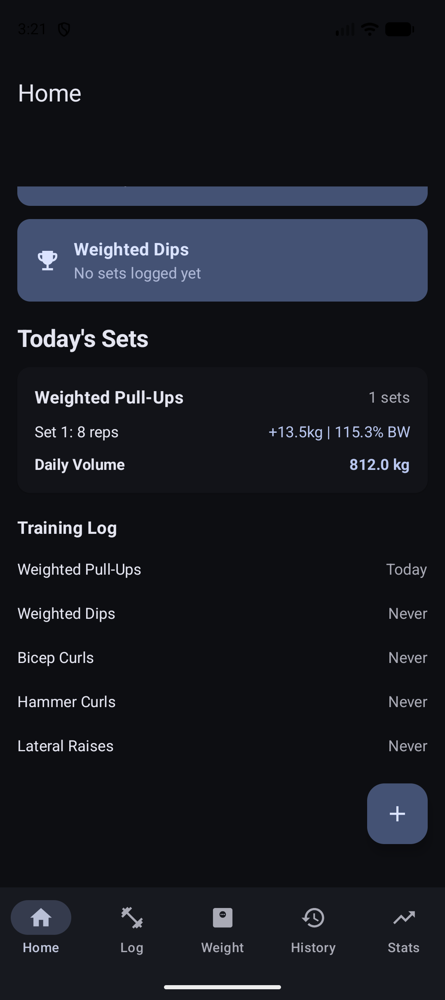
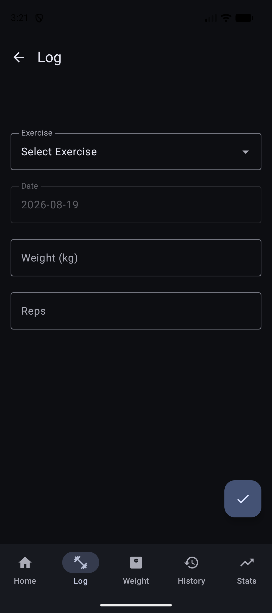
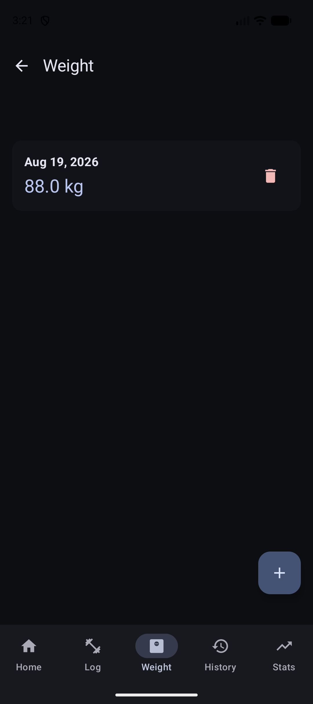
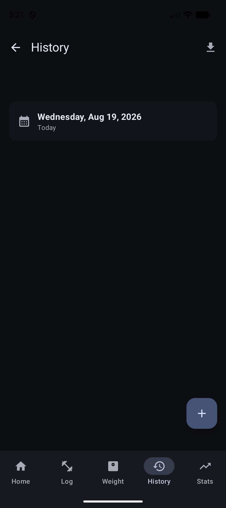
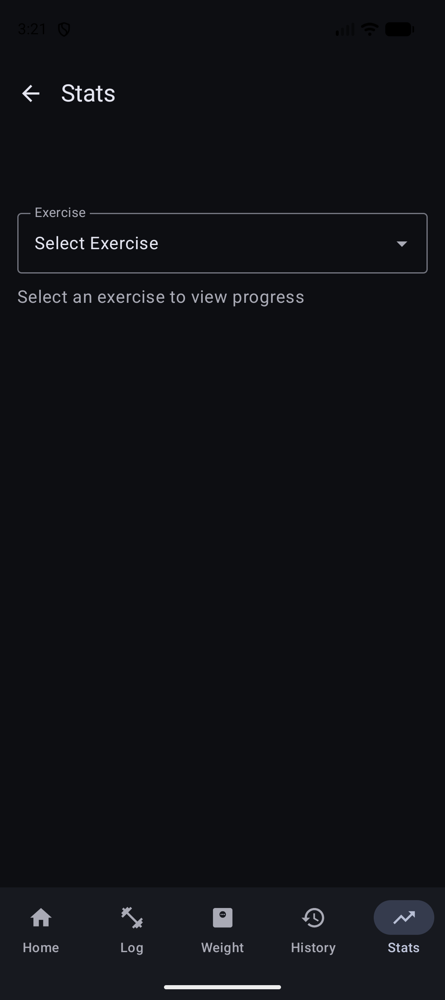
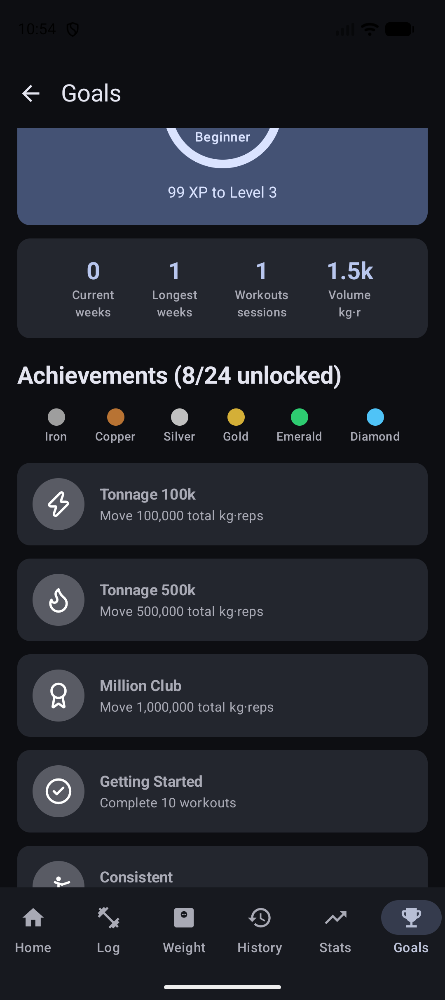

# Tr3ack

A workout tracker Android app for logging strength-training sessions, tracking body weight, and visualizing progress over time. Built for weighted calisthenics — pull-ups, dips, chin-ups — and free weight exercises.

## Screenshots

<p align="center">
  
  &nbsp;&nbsp;
  
  &nbsp;&nbsp;
  
</p>
<p align="center">
  
  &nbsp;&nbsp;
  
  &nbsp;&nbsp;
  
</p>

## Features

- **Dashboard** — At-a-glance view of today's body weight, personal bests, and recent activity
- **Log Workouts** — Select exercise, set reps/weight, pick any date for backfilling; weight persists between sets for fast logging
- **Body Weight Tracking** — One entry per day, editable, with fallback lookup for workout days without a log
- **Personal Record Card** — Single best-set record per exercise, selected by highest estimated 1RM across all logged sets; shows e1RM, set, total system load, % BW, and date achieved
- **Estimated 1RM Card** — Calculated from the set with the highest estimated 1RM using the Mayhew equation; includes BW multiplier, working loads (85/80/75%), and added weight needed at current BW
- **3 Progress Charts** (30/90 trained-day window):
  - **Estimated 1RM** — Line chart with gradient fill, a dashed rolling-average trend line, and rings marking sessions that set a new all-time PR
  - **Session Tonnage** — Bar chart of total work capacity (kg·reps) for deload detection
  - **Belt Load vs Body Weight** — Dual-line chart showing relative strength gains during cuts/bulks (bodyweight exercises only)
- **History** — Browse all logged sessions by date, edit or delete any past set
- **Achievements** — Gamified Goals tab: overall level + XP (from training volume and sessions), training streaks (consecutive **weeks** with ≥1 workout), and 30 tier-colored achievements for volume, consistency, relative strength, PR coverage, body-weight tracking, and per-exercise strength benchmarks (all computed retroactively from your data, ranked Iron → Copper → Silver → Gold → Emerald → Diamond). Badges use a consistent custom vector icon set (pull-up, dumbbell, lateral-raise, and Lucide-style glyphs) tinted to their tier color
- **CSV Export** — Export all workout data as a formatted CSV file from the History screen
- **JSON Backup & Restore** — Full data backup/restore from the Dashboard overflow menu; exports editable JSON file containing all exercises, sets, and body weight entries
- **Splash Screen** — Custom branded launch screen with the same vector dumbbell glyph as the app icon
- **App Icon** — Adaptive vector launcher icon (stroke-style dumbbell on black) shared with the splash screen
- **Dark Mode** — Always-on dark theme

## Exercises

| Exercise          | ID | Type                | Tracked Metrics                                      |
| ----------------- | -- | ------------------- | ---------------------------------------------------- |
| Weighted Pull-Ups | 1  | Weighted bodyweight | E1RM, Tonnage, Belt vs BW, System weight, % BW      |
| Weighted Dips     | 2  | Weighted bodyweight | E1RM, Tonnage, Belt vs BW, System weight, % BW      |
| Weighted Chin-Ups | 3  | Weighted bodyweight | E1RM, Tonnage, Belt vs BW, System weight, % BW      |
| Bicep Curls       | 4  | Free weight         | E1RM, Tonnage, Weight x reps                         |
| Lateral Raises    | 6  | Free weight         | E1RM, Tonnage, Weight x reps                         |

## Stats — How E1RM Works

### Bodyweight Exercises (Pull-Ups, Dips, Chin-Ups)

Uses the same Mayhew et al. (1992) equation as free weights, applied to the **total system weight** (`TSL = Body Weight + Added Weight`):

```
E1RM = TSL × 100 / (52.2 + 41.9 × e^(-0.055 × Reps))
```

Why: Mayhew is validated on 1–15-rep sets and is exponential (so it behaves above 10 reps where linear rep→%1RM models drift), and in LeSuer et al. (1997) it was one of only two formulas not significantly different from the measured 1RM for the exercises tested. It replaces the earlier hand-tuned per-movement coefficient tables, which on logged training data sat ~2–3% below Mayhew and were no more internally consistent — the cost is dropping the pull-up/dip/chin-specific curve flavor (chin-ups no longer get a separate bicep-leverage bump). A true single (1 rep) returns the raw TSL (no inflation); reps above 15 are capped at 15 (`MAX_BODYWEIGHT_REPS`, matching Mayhew's validated range) and sets above the cap still count toward tonnage.

### Free Weight Exercises

Uses the Mayhew et al. (1992) equation:

```
E1RM = 100 × Weight / (52.2 + 41.9 × e^(-0.055 × Reps))
```

Why Mayhew: it is an exponential curve, not a linear one, so it keeps estimating sensibly **above 10 reps** where Epley/Brzycki start to drift (the rep→%1RM relationship gets unreliable past 10). In the LeSuer et al. (1997) head-to-head of seven formulas against measured 1RMs, Mayhew was one of only two not significantly different from the true value, and it runs slightly below plain Epley at moderate reps (19 kg × 9 → 24.4 vs 24.7), i.e. the conservative direction for light isolation work. A true single (1 rep) returns the weight unchanged (no inflation); rep counts above 15 are capped at 15 (`MAX_FREE_WEIGHT_REPS`) because Mayhew was validated on 1–15-rep sets — beyond that the estimate stops extrapolating rather than drifting.

## Stats — Other Charts

- **Session Tonnage** = Sum of (TSL × Reps) across all sets in a session. Tracks total work capacity — useful for identifying overtraining or verifying volume before a deload.
- **Belt Load vs Body Weight** — Plots added weight (belt load) and body weight on the same axis over time. During a cut, the belt load line rising while body weight drops = improving relative strength.

## Gamification — Achievements Tab

The Goals tab turn your training history into progression, all computed on the fly from existing data (no DB changes).

**Level & XP**
- XP = `(total kg·reps / 10) + workouts × 50`
- Level curve grows ×1.4 per level (starts at 100 XP); tiers: Novice → Beginner → Rookie → Apprentice → Trainee → Grinder → Strong → Advanced → Elite → Beast

**Streaks** — current and longest consecutive training-day streaks.

**Achievement tiers** — every achievement is colored by how hard/long it takes to earn:

| Tier | Color | Typical unlock |
| --- | --- | --- |
| Iron | Gray | First milestones (10 workouts, 100k tonnage, 16kg curls, 10kg raises) |
| Copper | Copper | 50 workouts, 500k tonnage, 4-week streak, intermediate curls/raises |
| Silver | Silver | 12-week streak, 1.25× BW, mid curls/raises |
| Gold | Gold | 26-week streak, 1.5× BW, advanced curls/raises |
| Emerald | Green | 1.75× BW, heavy curls/raises |
| Diamond | Cyan | 1M tonnage, 100 workouts, elite curls/raises |

**Per-exercise strength benchmarks** (unlock by logging a set at that weight for 6+ reps, each ranked through the 6 tiers):

| Exercise | Good+ | Intermediate | Intermediate+ | Advanced | Advanced+ | Elite |
| --- | --- | --- | --- | --- | --- | --- |
| Bicep Curls | 16kg | 18kg | 20kg | 22kg | 24kg | 26kg |
| Lateral Raises | 10kg | 12kg | 14kg | 16kg | 18kg | 20kg |

You can mix-and-match exercises (e.g. sets up to 22kg) to chase the color tiers you want.

## CSV Export

Export your data from the History screen (download icon in the top bar). The CSV includes:

| Column | Description |
| --- | --- |
| Date | Workout date |
| Exercise | Exercise name |
| Added Weight (kg) | Added weight per set in order (e.g. 20.0-19.0-19.0) |
| Total System Weight (kg) | Body Weight + Added Weight per set in order (or just weight for free weight) |
| % of Body Weight | Total System Weight / Body Weight × 100 (only shown when all added weights are the same for bodyweight exercises) |
| Reps | Reps per set (e.g. 6-7-5) |
| Volume (kg) | Sum of (Total System Weight × Reps) |

## JSON Backup & Restore

Full data backup available from the Dashboard overflow menu (⋮). Exports a `Tr3ack_Backup_<date>.json` file containing all exercises, workout sets, and body weight entries. The file is human-readable and hand-editable — open it in any text editor to tweak values before re-importing.

| Section | Fields |
| --- | --- |
| `meta` | version, export date, record counts |
| `exercises` | id, name, isBodyweightBased |
| `workoutSets` | id, exerciseId, date, addedWeightKg, reps, timestamp |
| `bodyWeightEntries` | id, date, bodyWeightKg |

Importing a backup replaces all current data. A confirmation dialog is shown before restore.

## Key Metrics

- **Total System Weight** = Body Weight + Added Weight
- **% Body Weight** = (Total System Weight / Body Weight) × 100
- **Estimated 1RM** = Mayhew equation × TSL (bodyweight) or Mayhew equation on the lifted weight (free weight)
- **Personal Record** = The single set with the highest estimated 1RM across all history; all card values (load, reps, % BW, date) come from that one set
- **Session Tonnage** = Sum of (TSL × Reps) per session
- **Daily Volume** = Sum of (TSL × Reps) per day

## Tech Stack

- Kotlin + Jetpack Compose (Material 3)
- MVVM + Repository pattern
- Room (SQLite) for local persistence (v3)
- Navigation Compose
- AndroidX SplashScreen API
- Custom Canvas charts (E1RM line, Tonnage bar, Belt vs Body dual-line)

## Install

**USB:**

```bash
./gradlew installDebug
```

**APK:**
Transfer `app/build/outputs/apk/debug/app-debug.apk` to your phone and open it.

> Data persists across updates. Never uninstall if you want to keep your logs — always install over the existing app. DB migrations handle schema changes automatically.

## Min SDK

26 (Android 8.0)

## AI Assistance

This project was developed with the assistance of AI.
